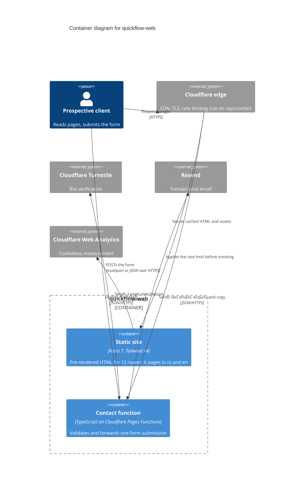

# Container Diagram: quickflow-web

Level 2 of the C4 model. The deployable pieces inside the system boundary.

## Notes

Two containers, and the second one is twenty lines of code. That is the whole
system, and it is the point: ADR-0001 chose static output precisely so that
there is nothing else to deploy, scale or monitor.

There is no database container. Submissions are forwarded and not stored, per
the spec, section 5. Anything that needs to be recalled later lives in the
inbox.

The rate limit is drawn on the Cloudflare edge rather than inside the function
because that is where it actually runs (ADR-0003). It is dashboard
configuration, not code, which means a fresh deployment does not restore it.
That is the diagram earning its keep: the dependency is invisible in the
repository.

## Honest assessment

For a system this small, the container diagram tells a reader almost nothing
they would not get from one paragraph. It is kept because it makes two things
explicit that are genuinely easy to forget: that the rate limit is not in the
code, and that nothing is stored.
