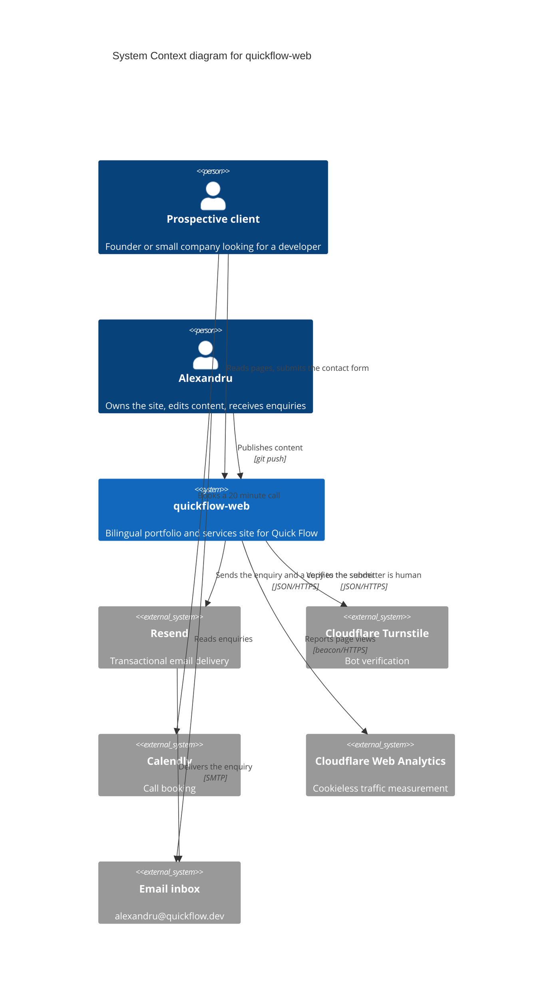

# System Context: quickflow-web

Level 1 of the C4 model. Who uses the site and what it talks to.

## Notes

The site has no users in the authentication sense. Nobody signs in, and the spec
rules out any logged-in area.

Calendly sits outside the system boundary on purpose. The site only links to it,
it does not call its API, so a Calendly outage degrades the contact page without
breaking it. The spec, flow 3.2, requires the email address to be visible as
text next to that link for exactly this reason.

The email inbox is drawn as an external system because it is where an enquiry
actually lands. Treating it as part of the site hides the fact that a delivery
failure after Resend accepts the message is invisible to us (see ADR-0004).
