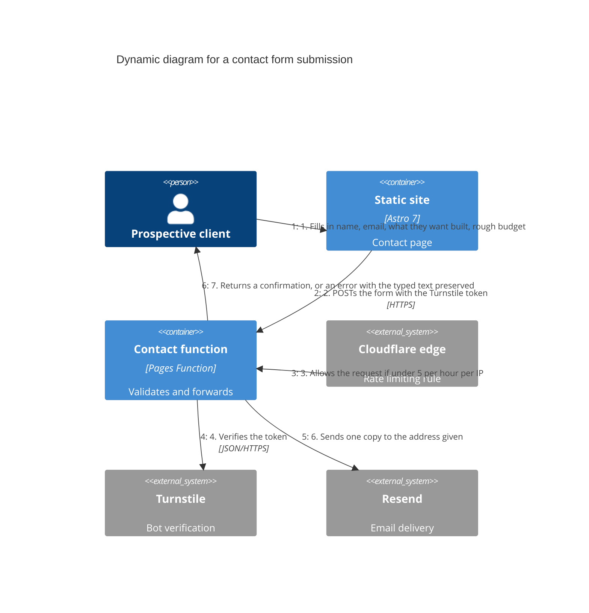

# Dynamic Diagram: contact form submission

The only request flow in the system with more than one step. Covers the happy
path and names where each failure from the spec, section 3.1, is handled.

## Failure handling

| Failure | Where it is handled | What the visitor sees |
|---|---|---|
| Required field empty | Step 2, in the browser, and again in the function | An error next to each field, with the typed text kept |
| Turnstile token missing or invalid | Step 4 | A generic failure with the email address offered as an alternative |
| More than 5 submissions per hour from one IP | Step 3, at the edge, before the function runs | A Cloudflare block page |
| Someone else's address typed in, to relay mail | Step 6, exactly one copy per submission, plus the rate limit at step 3 | Normal confirmation. The abuse is bounded, not detected |
| Resend unavailable | Step 5 | A message saying it could not be sent, the typed text kept, and the email address as a fallback. The function does not pretend to have received it |

The last row is a correction made during the spec review. The first draft said
the submission would be stored and sent later, which contradicted section 5 of
the same document: nothing is stored.

## Progressive enhancement

Without JavaScript, step 2 is a plain form POST and step 7 is a full page
response. With JavaScript, the same endpoint is called with fetch and step 7
updates the page in place. The endpoint behaves identically either way, which is
why there is only one flow to draw (ADR-0001).
